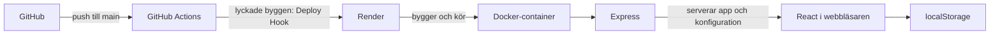

# Workout Tracker

Workout Tracker är en enkel webbapplikation för att spara träningspass. Du kan skapa namngivna pass och lägga till flera set med övning, vikt, repetitioner och en valfri beskrivning. Du kan visa och ta bort både set och hela pass. Passen sparas i webbläsarens localStorage, så de finns kvar efter en uppdatering på samma enhet och i samma webbläsare. De delas inte mellan enheter och kan försvinna om webbläsarens lagring rensas.

Projektet använder React, Vite, Express, Docker, GitHub Actions och Render. React med Vite valdes för att enkelt bygga och utveckla ett gränssnitt med snabb lokal utveckling. Express serverar den färdiga React-appen och ger appen konfiguration och en health check.

## Lokal utveckling

Installera Node.js 22 och kör i projektmappen:

```bash
npm ci
```

Kopiera `.env.example` till `.env` och ändra värdena vid behov. Starta Express i en terminal:

```bash
npm run server
```

Starta Vite i en annan terminal:

```bash
npm run dev
```

Öppna adressen som Vite visar, normalt `http://localhost:5173`. Vite skickar anrop till `/api` och `/health` vidare till Express på port 3000. Om du ändrar `PORT` lokalt behöver du även ändra porten i `vite.config.js`.

För att prova produktionsbygget utan Docker, kör `npm run build` och därefter `npm run server`. Öppna `http://localhost:3000`.

## Docker

Bygg och starta en separat image och container:

```bash
docker build -t workout-tracker .
docker run --rm -p 3000:3000 workout-tracker
```

Öppna `http://localhost:3000`. Stoppa containern med Ctrl+C. För att ange en titel lokalt kan du köra:

```bash
docker run --rm -p 3000:3000 -e "APP_TITLE=Min Workout Tracker" workout-tracker
```

## Miljövariabler

`.env.example` visar vilka variabler som kan användas. Kopiera filen till `.env` för lokal utveckling; `npm run server` läser den med Node.js. Starta om servern efter ändringar. `.env` och andra lokala `.env`-filer ignoreras av Git och skickas inte med till Docker-imagen. Lägg aldrig hemligheter i `.env.example` eller i källkoden.

- `APP_TITLE` styr titeln som Express skickar via `/api/config` och React visar. Utan variabeln används `Workout Tracker`. Använd exempelvis en utvecklingstitel i `.env` och en annan titel på Render. Titeln skickas till webbläsaren och är därför inte hemlig.
- `PORT` styr serverns port och är normalt 3000 lokalt. Render anger porten för sin tjänst; servern använder den automatiskt.
- `NODE_ENV=production` sätts i Docker för produktionsläge.

På Render anger du `APP_TITLE` under tjänstens **Environment**. Ändringar kan kräva en ny driftsättning. Deploy Hook-URL:en är däremot en hemlighet och ska endast läggas i GitHub Actions Secrets, inte i koden eller README.

## Loggning och health check

Servern använder `console.info` när den startar och när `/health` anropas. Öppna `/health`, exempelvis `http://localhost:3000/health`, för att kontrollera att servern svarar med `{"status":"ok"}`. På Render kan `/health` anges som tjänstens Health Check Path.

För att demonstrera en fellogg, kör följande mot din lokala server eller ersätt adressen med din Render-adress:

```bash
curl -X POST http://localhost:3000/api/log-error
```

I PowerShell kan du i stället använda `curl.exe -X POST http://localhost:3000/api/log-error`. Endpointen ger avsiktligt HTTP 400 och servern skriver ett fast meddelande med `console.error`. Den loggar inga inskickade data. Öppna **Logs** på Render för att se startmeddelandet, health check och demonstrationsfelet. Loggarna och svaret från `/health` hjälper dig att se om servern startat och svarar.

## GitHub Actions

När kod pushas till `main` hämtar workflowen koden, installerar Node.js och beroendena med `npm ci`, bygger React med `npm run build` och bygger en Docker-image. Om alla steg lyckas anropar den Render Deploy Hook. Om ett steg misslyckas stoppas jobbet och hooken anropas inte. Inga automatiserade tester körs och imagen publiceras inte på Docker Hub.

## Render och GitHub

1. Lägg upp projektet i ett GitHub-repository och pusha till `main`.
2. Skapa en Web Service på Render och koppla repositoryt. Välj `main` och Docker som runtime. Render bygger från projektets Dockerfile.
3. Välj plan, ange `APP_TITLE` under **Environment** och ange `/health` som Health Check Path. Render tillhandahåller `PORT`.
4. Stäng av **Auto-Deploy** i tjänstens inställningar. Då startar inte en ny driftsättning automatiskt vid varje push innan GitHub Actions har kontrollerat byggena.
5. Skapa eller kopiera tjänstens Deploy Hook i Render. Behandla hela URL:en som en hemlighet.
6. Öppna repositoryts **Settings → Secrets and variables → Actions**, skapa en repository secret med namnet `RENDER_DEPLOY_HOOK_URL` och klistra in hookens URL.
7. Pusha en ändring till `main`. Kontrollera i fliken **Actions** att alla steg lyckas och därefter på Render att driftsättningen lyckas. Hooken ber Render att bygga och driftsätta; ett lyckat hook-anrop innebär inte i sig att driftsättningen är färdig.
8. Öppna den publika adressen och kontrollera appen och `/health`. Anropa demonstrationsfelet och kontrollera **Logs**. Ta skärmbilderna som krävs för inlämningen.

**Publik Render-länk:** Fyll i här efter driftsättning.

## Kostnadsmedveten drift

1. **Plan:** Fyll i vald Render-plan här när tjänsten skapas.
2. **Val:** Fyll i varför planen valdes, exempelvis utifrån skolprojektets behov och aktuell prisinformation.
3. **Kostnad:** Vald plan, antal tjänster, driftstid, trafik och eventuell annan resursanvändning kan påverka kostnaden. Kontrollera aktuella villkor och priser hos Render.
4. **Minska resursanvändning:** Använd en liten tjänst som räcker för behovet och undvik onödiga tjänster och anrop.
5. **Begränsningar:** En liten instans har begränsad kapacitet. Passen lagras bara lokalt i varje webbläsare, så de kan inte delas eller återställas från servern. Planens övriga begränsningar beror på vad som väljs.
6. **Fler användare:** Mät belastningen och välj vid behov större eller flera instanser. Om passen ska synkroniseras mellan enheter behövs även en backend med databas och lämplig åtkomstkontroll.

## Arkitektur


